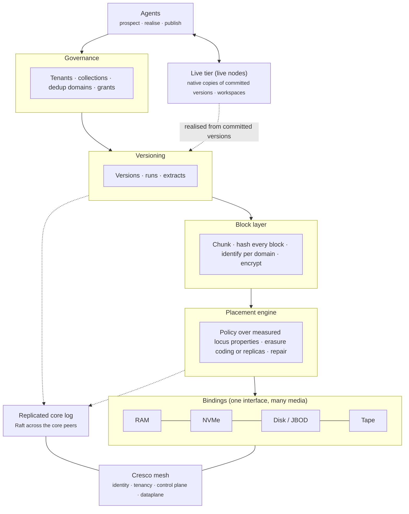

# Architecture

## The layers

| Layer | What it does | Status |
|---|---|---|
| Agent interface | `prospect` returns costed options for getting a version somewhere; `realise` is the only call that moves bytes; `publish` creates a version | `publish` **Built** (1.3); `prospect` and `realise` to a live node **Built** with the live tier (2026-10-28, development branch); the wider Entail interface **Designed** |
| Governance | Tenants own collections; each collection carries compliance and deduplication policy; grants allow cross-collection and cross-tenant references | **Built** (1.3): the four dedup modes, grants with withdrawal terms, tenant-scoped roles |
| Versioning | Immutable versions built from runs; extracts as citable, pinnable point-in-time objects | **Built** (1.3): versions, branches, history, extracts and citations; the run-and-root container layout **Designed** |
| Block layer | Split content into blocks, hash every block before storage, derive its identity and key according to the collection's domain | **Built** (1.3): blocks of at least 1 MiB, chunker per dataset, format-aware adapters, per-domain identity and keys |
| Placement engine | Chooses where copies or shares go using measured properties and policy; repairs lost ones | **Built**: measured placement, fail-closed durability, `ec:2+1` shares by default since 2026-10-14, tape as a placement target |
| Bindings | One interface every storage medium implements | **Built**: filesystem, RAM, pack store, remote storage nodes, tape (simulated drives and virtual drives); raw NVMe and raw disk **Designed** |
| Replicated core log | The journaled, Raft-replicated log of the core's state: versions, placements, the node registry, jobs, the audit anchors | **Proven** (1.3, the HPC fabric check) |
| Live tier | Committed versions as plaintext native files on live nodes near compute, in a journaled inventory; workspaces publish new versions; never counted toward durability ([The live tier](live-tier.md)) | **Built** and tested (2026-10-28, development branch); final-build runs in progress |
| Cresco mesh | Transport, identity, tenant isolation, QoS | **Proven** (Cresco 1.3) |

## Two paths through the system

**Writing a version.** An agent publishes changes to a collection. The block layer splits the new
content into blocks and hashes each one. The collection's policy decides whether a block with that
hash already exists in the collection's deduplication domain; if so, the new version only
references it. New blocks are encrypted and handed to the placement engine. Under the default
`ec:2+1`, each block's ciphertext is split into two data shares and a parity share, one per site, each
written to a locus able to show that its writes reach durable storage. The core's replicated log records
the version once a majority of the core peers has it. With tape as the primary tier, a durable version then
commits when its tape copies
are verified; until then reads answer `COMMITTING`.

**Reading a version.** An agent names a version (or an extract) and reads it through the core, which
streams it from the nearest copies or stages it from tape first, verifying every block as it streams. In the
design of record, `prospect` returns the options for getting a version somewhere (stream it, recall it
from tape first, or send the computation to the data), each with a cost interval and the constraint that
binds it, and `realise` carries one out; the live tier builds the first of these. To a live node, `realise` makes the version, once committed, into ordinary files that programs read
in place; the core registers the copy first and can delete it again ([The live tier](live-tier.md)).

## What runs today

**Release 1.3** (2026-10-01) is the storage core that runs on the HPC test deployment, as a Cresco
plugin. Core peers keep the core's state in a Raft-replicated log; storage nodes are blind extent stores
that hold only ciphertext and answer only the core's signed requests; each site's durable tier is a tape
library, on simulated and virtual drives until hardware arrives. Every request is signed, every verb is
authorised and audited, and long operations are asynchronous jobs. The deployment runs one Cresco region
per site since 2026-10-24/25. See [Release 1.3](../built/release-1-3.md) and
[Status at a glance](../built/status.md).

Built since, and dated where it is described:

- **Erasure coding** `ec:2+1` is the default for new collections since 2026-10-14; full replicas and a
  single copy stay per-dataset choices ([Durability](durability.md)).
- **The live tier and the stability work** are built and tested on the development branch (2026-10-28),
  and wait for their gate and a merge: [The live tier](live-tier.md) and
  [Stops, restarts and slow disks](stops-and-restarts.md).

**The September prototype is retired.** Its storage path (a federation index, erasure-coded fragments
across sites, a site key in Shamir custody) was removed from the plugin on 2026-10-08; a former index peer
reads the prototype's journal once, for the core's legacy import. Its results remain the record of what it
proved: see [The prototype](../built/prototype.md).

**Not built yet:** tape on real drives, raw NVMe and raw disk bindings, and the wider agent interface of
the design record (receipts, coverage and purposes, moving computation to the data).
